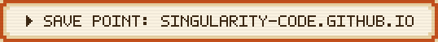

  

  

  

  

  

  
  
  
  

★ BONUS STAGE ★ Korean translations of
  <a href="https://github.com/singularity-code/ko.reactjs.org">ko.reactjs.org</a> &amp;
  <a href="https://github.com/singularity-code/ko.javascript.info">ko.javascript.info</a>

  

